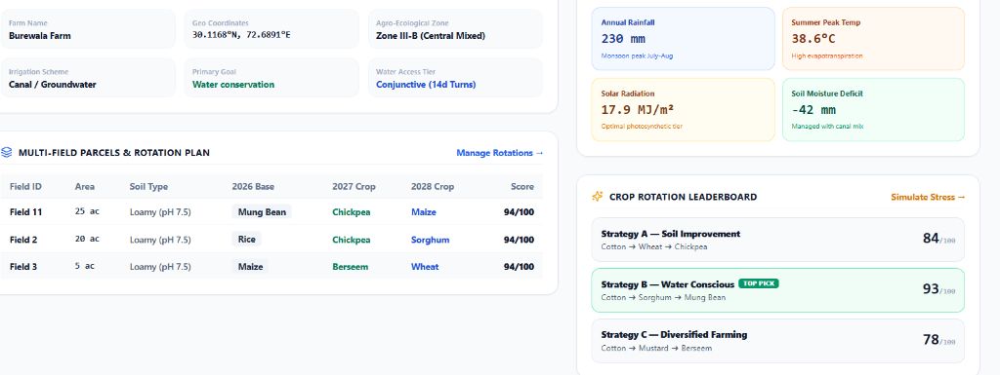
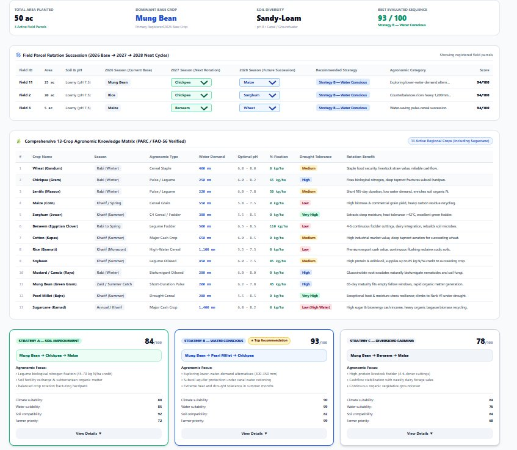
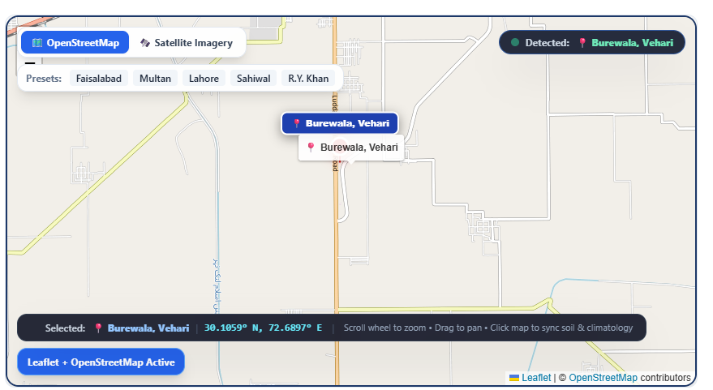
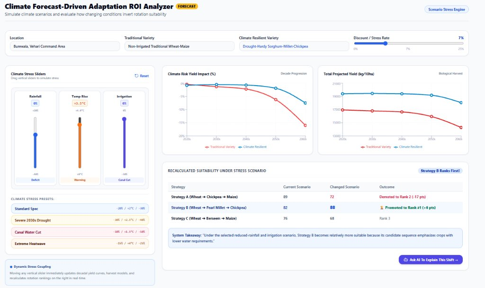
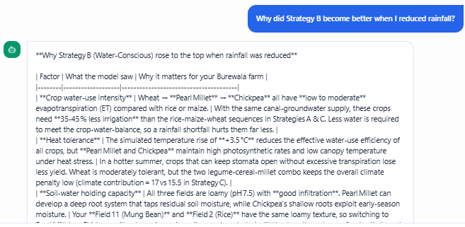

# 🌾 AgroShift AI — Climate-Smart Crop Succession & Resilient Agronomy Engine
> **NASA Space Apps Challenge 2026**  
> *Transforming NASA Earth Observations into Resilient Crop Rotations, Decadal Yield Risk Projections, and Interactive Climate Stress Simulations*

[](https://agroshift-ai-nu.vercel.app)
[](https://github.com/MuhammadAreebKhadim/agroshift_ai.git)
[](https://nextjs.org/)
[](https://www.typescriptlang.org/)
[](https://tailwindcss.com/)
[](https://power.larc.nasa.gov/)

---

## 📸 Visual Showcase & Platform Tour

### 1. Farm Demographics & Real-Time Succession Dashboard
Real-time integration of farm coordinates, multi-field parcel succession plans, NASA climatological metrics, and live crop rotation leaderboard.


### 2. Rotation Succession Planner & 13-Crop Agronomic Engine
Evaluates 3 optimal rotational strategies with dynamic scientific rationale synthesis, interactive parcel succession dropdowns ($2026 \to 2027 \to 2028$), and the 13-crop PARC/FAO-56 verified knowledge matrix.


### 3. OpenStreetMap Leaflet Geo-Detection & Agro-Ecological Mapping
Interactive geographic boundary locator with satellite layer toggle, regional command area presets, and automatic agro-ecological zone detection.


### 4. Climate Forecast-Driven Adaptation ROI Analyzer & What-If Stress Simulator
Parametric climate stress engine featuring vertical sliders ($-40\%$ Rain, $+4.0^\circ\text{C}$ Heat, $-50\%$ Canal Water), decadal yield impact curves ($2020s \to 2060s$), future climate hazard alerts, and recalculated suitability scoring.


### 5. AgriAI Advisor Grounded Agronomic Consultation
Context-aware, structured markdown responses grounded in live farm demographics, NASA observations, and simulated stress curves.


---

## 🌟 Executive Summary

Traditional digital agriculture tools suffer from a fatal flaw: they recommend only a **single, isolated crop** based on basic chemical soil tests. In reality, modern agriculture depends on **multi-season crop rotation sequences** to break pest cycles, prevent aquifer exhaustion, and biologically restore soil fertility.

**AgroShift AI** bridges the gap between **NASA Earth Observations** and field-level agronomic decision-making. By coupling 365-day satellite meteorological data from **NASA POWER** with a deterministic 13-crop agronomic matrix and an interactive **What-If Climate Stress Simulator**, AgroShift AI empowers smallholders and agricultural policymakers to visualize, evaluate, and adapt multi-year crop successions against rising heat and water scarcity.

---

## 🚀 Key Innovations & Differentiators

| Conventional Farming Apps | AgroShift AI |
| :--- | :--- |
| **Isolated Crop Advice**: Suggests only a single crop for next season | **Multi-Year Succession Planning**: Evaluates 3-year rotational sequences ($2026 \to 2027 \to 2028$) |
| **Static Soil Test Input**: Relies solely on laboratory NPK numbers | **NASA POWER Climatology**: Integrates precipitation, surface temperature, and solar insolation |
| **Blackbox Opaque AI**: Unexplainable recommendation scores | **100% Transparent Formula**: $30\%$ Climate + $25\%$ Water + $25\%$ Soil + $20\%$ Priority |
| **Static Output**: One-time static recommendations | **Interactive What-If Simulator**: Real-time stress engine with vertical sliders and decadal yield curves |
| **Hallucinated Chatbots**: Ungrounded general-purpose LLMs | **AgriAI Advisor**: Grounded in field parcels, NASA observations, and stress outcomes |

---

## 🌾 Comprehensive 13-Crop Agronomic Knowledge Matrix

Verified against standards from the **Food and Agriculture Organization (FAO-56)**, the **Pakistan Agricultural Research Council (PARC)**, and regional extension bulletins:

| # | Crop Name | Botanical Name | Season | Water Demand | Optimal pH | Biological N-Fixation | Drought Tolerance | Primary Rotation Benefit |
|:-:|:---|:---|:---|:---:|:---:|:---:|:---:|:---|
| 1 | **Wheat** | *Triticum aestivum* | Rabi (Winter) | $400\text{ mm}$ | $6.0 - 8.0$ | $0\text{ kg/ha}$ | Medium | Staple food security, straw value, reliable cashflow. |
| 2 | **Chickpea** | *Cicer arietinum* | Rabi (Winter) | $250\text{ mm}$ | $6.0 - 8.2$ | $65\text{ kg N/ha}$ | High | Biological nitrogen fixation, taproot fractures subsoil hardpan. |
| 3 | **Lentils** | *Lens culinaris* | Rabi (Winter) | $220\text{ mm}$ | $6.0 - 7.8$ | $50\text{ kg N/ha}$ | Medium | Short 105-day cycle, low water demand, enriches organic N. |
| 4 | **Maize** | *Zea mays* | Kharif / Spring | $550\text{ mm}$ | $5.8 - 7.5$ | $0\text{ kg/ha}$ | Low | High biomass commercial grain yield, heavy residue recycling. |
| 5 | **Sorghum** | *Sorghum bicolor* | Kharif (Summer) | $380\text{ mm}$ | $5.5 - 8.5$ | $0\text{ kg/ha}$ | Very High | Scavenges subsoil moisture, heat tolerant $>42^\circ\text{C}$, premium green fodder. |
| 6 | **Berseem** | *Trifolium alexandrinum* | Rabi to Spring | $500\text{ mm}$ | $6.5 - 8.5$ | $110\text{ kg N/ha}$ | Low | 4–6 continuous fodder cuttings, dairy integration, rebuilds soil microbes. |
| 7 | **Cotton** | *Gossypium hirsutum* | Kharif (Summer) | $650\text{ mm}$ | $6.0 - 8.5$ | $0\text{ kg/ha}$ | Medium | Major cash crop, deep taproot aeration for succeeding wheat. |
| 8 | **Rice** | *Oryza sativa* | Kharif (Monsoon) | $1,100\text{ mm}$ | $5.5 - 7.5$ | $0\text{ kg/ha}$ | Low | High export revenue, continuous standing water flushes sodic salts. |
| 9 | **Soybean** | *Glycine max* | Kharif (Summer) | $450\text{ mm}$ | $6.0 - 7.5$ | $65\text{ kg N/ha}$ | Medium | High protein edible oilseed, leaves $+65\text{ kg N/ha}$ credit for succeeding crop. |
| 10 | **Mustard** | *Brassica juncea* | Rabi (Winter) | $280\text{ mm}$ | $6.0 - 8.0$ | $0\text{ kg/ha}$ | High | Glucosinolate root exudates naturally biofumigate nematodes and soil fungi. |
| 11 | **Mung Bean** | *Vigna radiata* | Zaid / Summer Catch | $200\text{ mm}$ | $6.2 - 7.8$ | $45\text{ kg N/ha}$ | High | 65-day maturity fits empty fallow windows, rapid organic matter build. |
| 12 | **Pearl Millet** | *Pennisetum glaucum* | Kharif (Summer) | $280\text{ mm}$ | $5.5 - 8.5$ | $0\text{ kg/ha}$ | Very High | Extreme heat & moisture stress resilience; climbs to Rank #1 under drought. |
| 13 | **Sugarcane** | *Saccharum officinarum* | Annual / Kharif | $1,400\text{ mm}$ | $6.0 - 8.2$ | $0\text{ kg/ha}$ | Low (High Water) | High sugar and bioenergy cash income, heavy bagasse biomass recycling. |

---

## 🔬 Deterministic Agronomic Scoring Formula

To ensure transparency and trust with farmers and agronomists, AgroShift AI uses a deterministic mathematical evaluation model rather than unexplainable blackbox predictions:

$$\text{Overall Match Score} = (S_{\text{climate}} \times 0.30) + (S_{\text{water}} \times 0.25) + (S_{\text{soil}} \times 0.25) + (S_{\text{priority}} \times 0.20)$$

### 1. Climate Suitability ($S_{\text{climate}}$)
Calculated from NASA POWER daily maximum and minimum temperatures across the crop growing calendar:
$$S_{\text{climate}} = 100 - \left( \text{Heat Stress Days} \times 2.5 \right) - \left( \Delta T_{\text{optimal}} \times 3.0 \right)$$

### 2. Water Deficit Index ($S_{\text{water}}$)
Compares crop evapotranspiration ($ET_c$) against NASA POWER annual precipitation ($P$) and available irrigation water ($I$):
$$S_{\text{water}} = \max\left(30, 100 - \frac{|ET_c - (P + I)|}{ET_c} \times 100\right)$$

### 3. Soil Physico-Chemical Fit ($S_{\text{soil}}$)
Penalizes soil texture mismatches and pH nutrient lockout:
$$S_{\text{soil}} = 100 - \left( |\text{pH}_{\text{actual}} - \text{pH}_{\text{optimal}}| \times 12 \right) - \text{TexturePenalty}$$

### 4. Farmer Priority Alignment ($S_{\text{priority}}$)
Dynamically reweights candidates according to the farmer's operational goals (*Water Conservation*, *Soil Health & Nitrogen Fixation*, or *High Yield / Commercial Profit*).

---

## 🛰️ NASA Earth Observations Used

AgroShift AI interfaces with the **NASA Prediction of Worldwide Energy Resources (POWER)** Agroclimatology dataset:

| NASA Parameter | Description | Agronomic Utility in AgroShift AI |
|:---|:---|:---|
| **`PRECTOTCORR`** | Corrected Precipitation ($mm/day$) | Computes monthly rainfall totals, drought spells, and irrigation deficit ratios. |
| **`T2M`** | Temperature at 2 Meters ($^\circ\text{C}$) | Tracks monthly average thermal trends across vegetative growth stages. |
| **`T2M_MAX`** | Daily Maximum Temperature ($^\circ\text{C}$) | Identifies crop heat blast and pollination sterility hazards ($T_{\max} \ge 35^\circ\text{C}$). |
| **`T2M_MIN`** | Daily Minimum Temperature ($^\circ\text{C}$) | Detects winter chilling injury and frost risk for rabi pulses and clover. |
| **`ALLSKY_SFC_SW_DWN`** | All-Sky Surface Solar Irradiance ($MJ/m^2/day$) | Evaluates photosynthetic active radiation (PAR) and dry matter biomass potential. |

---

## 💻 Tech Stack & Architecture

```
                                    USER (Web Browser)
                                            │
                                            ▼
                    ┌──────────────────────────────────────────────┐
                    │     NEXT.JS 14 FRONTEND (React 18 & TS)      │
                    │  • Fullscreen Responsive Fluid Layout        │
                    │  • Tailwind CSS with Lucide Icons            │
                    │  • Recharts 12-Month Multi-Line Weather      │
                    │  • Leaflet Interactive OpenStreetMap Canvas  │
                    │  • Client-Side What-If Parametric Simulator  │
                    └───────────────────────┬──────────────────────┘
                                            │
                        ┌───────────────────┴───────────────────┐
                        ▼                                       ▼
            ┌──────────────────────┐                ┌──────────────────────┐
            │  VERCEL SERVERLESS   │                │   NASA POWER API     │
            │  EDGE API ROUTES     │                │   Agroclimatology    │
            │  • /api/farms        │                │   Daily Data Service │
            │  • /api/nasa/point   │                │   • PRECTOTCORR      │
            │  • /api/rotations    │                │   • T2M / T2M_MAX    │
            │  • /api/simulator    │                │   • ALLSKY Solar     │
            │  • /api/assistant    │                └──────────────────────┘
            └──────────┬───────────┘
                       │
                       ▼
            ┌──────────────────────┐
            │      GROQ API        │
            │  Llama-3.3-70b-Vers. │
            │  Grounded AI Copilot │
            └──────────────────────┘
```

---

## 🛠️ Local Development & Quickstart

### Prerequisites
- Node.js `18.x` or higher
- Python `3.11` or higher
- Git

### 1. Clone the Repository
```bash
git clone https://github.com/MuhammadAreebKhadim/agroshift_ai.git
cd agroshift_ai
```

### 2. Run the Next.js Frontend
```bash
cd frontend
npm install
npm run dev
```
Open [http://localhost:3000](http://localhost:3000) in your browser.

### 3. Run the FastAPI Backend (Optional Local Service)
```bash
cd backend
python -m venv .venv
.\.venv\Scripts\activate  # Windows
source .venv/bin/activate # Linux/macOS
pip install -r requirements.txt
uvicorn app.main:app --reload --port 8000
```

---

## 👥 Team: Hungry coders
- **Muhammad Areeb Khadim** — Lead Full-Stack Architect & Agronomic Modeling
- **Development Team** — NASA Data Integration, Climate Stress Engineering, UI/UX Design

*Developed for the NASA Space Apps Challenge 2026.*
